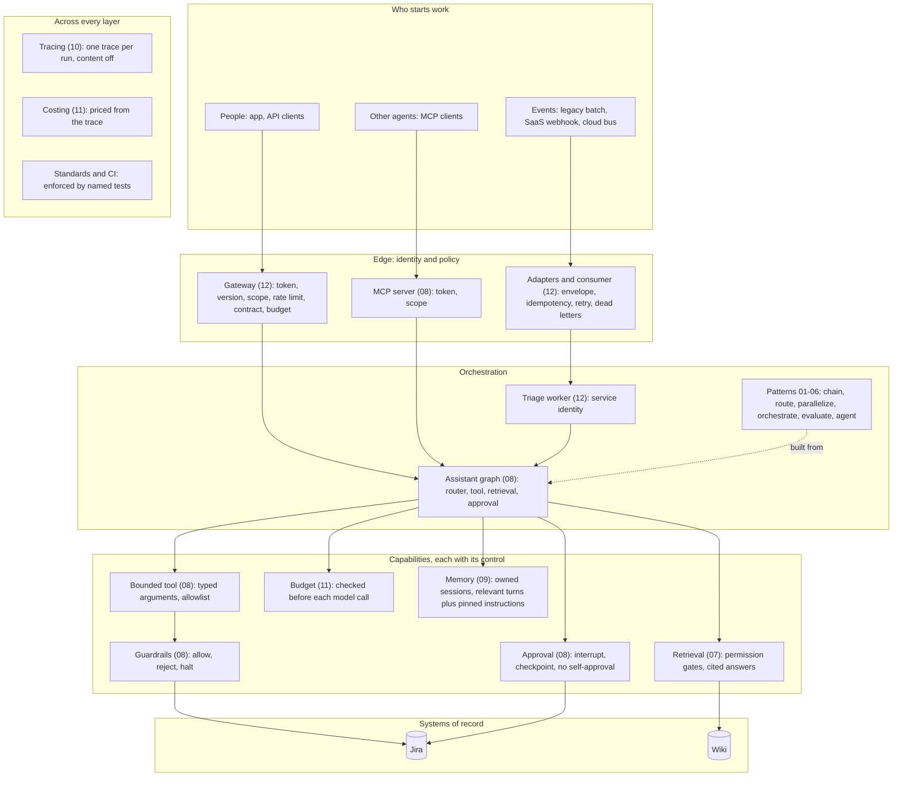

# Reference architecture: governed agents

One picture of how the modules in this repository fit together, what each layer
controls, and the number that shows the control works. Every layer below is
built and tested here. The parts that are not are listed at the end.

**The principle behind every layer:** use the simplest architecture that reliably
solves the problem, and back every claim with a number the repository produces.

## The layers

| Layer | Component | Module | Control | Evidence |
|---|---|---|---|---|
| Edge | Gateway | [12](../../12_integration/README.md#the-gateway) | Seven policies in a fixed order before any agent runs | A 25-request burst: 10 answered, 15 refused with `Retry-After: 6`; contract-invalid requests reach no agent |
| Edge | MCP server | [08](../../08_tools/README.md#tools-over-mcp) | Identity only from the verified token; scopes per tool | The same call returns 4 or 3 by token; a `user=` argument changes nothing |
| Edge | Event adapters and consumer | [12](../../12_integration/README.md) | One envelope; at least once in, exactly once handled | 60 messages with a crash, timeouts and duplicates: 4 outages, 4 requests, 4 comments |
| Orchestration | Patterns | [01-06](../../README.md#architecture-progression) | Every agent turn ends in a typed outcome | Every run states why it ended; a bad reply stops the run |
| Orchestration | Router | [08](../../08_tools/README.md#model-router-through-tool-calling) | A model where it earns its cost; rules as the baseline | Held-out: 18 to 19 of 20 against 9; $96 per million questions |
| Capability | Retrieval | [07](../../07_rag/README.md) | Permission gates before ranking; answers need a citation that resolves | 0 restricted chunks in 64 probe queries, against 224 with the filter off |
| Capability | Bounded tool | [08](../../08_tools/README.md#design-decisions) | Typed arguments, allowlist, the tool writes the query | Injection and raw JQL refused |
| Capability | Coverage check | [08](../../08_tools/README.md#coverage-check) | A query runs only when its project resolves to the user's words | It stops a half answer the bound allows |
| Capability | Guardrails | [08](../../08_tools/README.md#tool-guardrails) | Allow, coach or halt; security first | An out-of-scope query reaches Jira 0 times, 1 without the guardrail |
| Capability | Approval | [08](../../08_tools/README.md#human-approval) | Writes wait for a different person, on a durable checkpoint | Survives a restart; a lost response still posts once |
| Capability | Budget | [11](../../11_finops/README.md) | Spend plus a reserve checked before each model call | $0.001 a day: 10 answered, the 11th refused with no model call |
| Capability | Memory | [09](../../09_memory/README.md) | A session owned by one identity; relevant turns plus pinned instructions; never evidence for a check except the user's own pinned words | 28 of 30 recalled at 240 exchanges with 34 times fewer tokens than appending everything |
| Across | Tracing | [10](../../10_observability/README.md) | One trace per run; content off by default | 0 of 17 planted markers in the trace file; 17 of 17 with content on |
| Across | Costing | [11](../../11_finops/README.md) | Priced from a sourced file; unpriced is unknown, not $0 | Reproduces 9 recorded costs within 0.8% |
| Capability | Graph retrieval over logs | [14](../../14_knowledge_graph/README.md) | Permissions filter the vector query and the graph before ranking; answers cite only what they were shown | 0 unreadable items returned on any question set, with a widened-filter control; held-out 3: 16/26 multi-hop against 13/26 without the walk |
| Across | Paved road | [13](../../13_paved_road/README.md) | A use case is configuration on the platform; the build refuses a configuration that breaks a standard; an offline gate per use case blocks merges | Two use cases with 0 code lines each; the gate fails on a shared-code regression; 10 of 10 mutants killed |
| Across | Standards | [standards](standards.md), [scorecard](scorecard.md) | Each standard names the tests or static check that enforce it, per module | 72 of 80 standard-module pairs conform; CI fails on an unregistered gap or an expired exception |

## Who acts, and as whom

| Actor | Identity | Can | Cannot |
|---|---|---|---|
| A person through the app or gateway | Their own, from the token | Read what Jira and the wiki let them see; request a write | Approve their own write; name another user |
| An agent through MCP | The token holder's, never an argument | The same as the token holder, within the tool's scopes | Approve anything: there is no approve tool |
| Event-triggered triage | `svc-alert-triage`, a named service identity | Count, list, propose a comment | Approve its own request; reach a restricted project |
| An approver | Their own | Approve or decline a pending write | Approve a write they requested |

## Two paths through the system

**A person asks** (`POST /v2/ask`): the gateway checks the token, version, scope,
rate limit and contract. The router asks the budget, then the model. The model
picks a tool with typed arguments, and the guardrails and bound check them.
Jira answers as the caller, and the answer says it covers only what they can see.
One trace covers the whole request, and the meter charges the call to the caller.

**An outage is raised** (service alert, then Jira's webhook): the adapters convert
both into one envelope. The consumer skips redeliveries. Triage, keyed on the
incident, counts open incidents as the service identity and proposes a comment.
The run pauses for a person. On approval the comment posts once, even if the
response is lost.

## Mapping to managed services

| Here | Azure | AWS |
|---|---|---|
| Gateway | API Management | API Gateway |
| Broker and dead letters | Service Bus | SQS with a redrive policy |
| Event bus | Event Grid | EventBridge |
| Checkpoints, idempotency store | Azure SQL or Cosmos DB | DynamoDB |
| Traces | Application Insights through an OpenTelemetry exporter | CloudWatch or X-Ray through an OpenTelemetry exporter |
| Tokens | Entra ID, on-behalf-of exchange | Cognito or IAM Identity Center, token exchange |

## Not covered yet

- **Memory with a model summary:** 09's compaction uses a deterministic stand-in; a live comparison is not made yet.
- **Ethical walls in retrieval:** deny rules proven the way allow rules are.
- **Handoff leakage:** restricted context must not reach a worker that isn't cleared for it.
- **Production infrastructure:** shared state across processes, ordering and partitions.

The open exceptions to the standards are in the [exception register](standards.md#exception-register).
