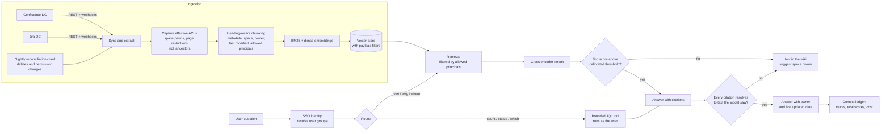

# Design: Permission-Aware RAG over Atlassian Data Center

> **Status: mostly design.** This document describes how the capability
> modules in this repo compose into one system. Pieces move from design to
> built as their modules land, and each one ships with the number that proves
> it. Built so far: retrieval, reranking, cited answers and abstention
> ([07_rag](../../07_rag)); permission-filtered retrieval with a leakage test on
> a synthetic wiki; and the router, the bounded Jira tool, guardrails, human
> approval and the MCP gateway against a mock Jira ([08_tools](../../08_tools)). Nothing here has been run against a
> live Confluence or Jira instance.

---

## The Problem

Engineering knowledge lives in two places. Confluence holds how things work:
runbooks, architecture pages, onboarding. Jira holds what happened: incidents,
changes, decisions buried in comments.

People ask both kinds of question:

- "How do I rotate the service credentials for the billing API?" is a
  knowledge question. Retrieval answers it.
- "How many P1 incidents did the billing platform have last quarter?" is an
  aggregation question. No amount of retrieval answers it. A query does.

Two constraints decide most of the design:

1. **Permissions are the whole game.** Confluence restricts pages by space and
   by page, and restrictions inherit from ancestor pages. Jira restricts issues
   by project permission scheme and by issue security level. An assistant that
   ignores either one becomes the easiest way to read a restricted page.
2. **The wiki is not clean.** Pages go stale, duplicate each other and
   contradict each other. The system has to show where an answer came from,
   who owns it and how old it is.

---

## Architecture

---

## Decisions

### 1. Two authorization strategies, one per path

The retrieval path and the tool path enforce permissions differently, on
purpose.

| Path | Who enforces access | Why |
| --- | --- | --- |
| Retrieval (Confluence) | This system, by replicating ACLs into the index | Vector search cannot ask Confluence per chunk. Permissions have to travel with the content. |
| JQL tool (Jira) | Jira itself | The tool calls Jira with the user's own token. Jira applies its permission schemes and issue security levels, so nothing is replicated and nothing can drift. |

Delegating to the source system is always preferred when the access pattern
allows it. Replication is used only where it cannot be avoided, and then it is
tested.

### 2. Effective permissions are computed at ingestion

A Confluence page is visible only if the user can view the space **and** passes
the view restrictions on the page **and** on every ancestor page. Each chunk
stores the resolved result as two payload fields:

- `allowed_groups`: groups that can view the page
- `allowed_users`: individual users named in restrictions

At query time the user's groups come from SSO, and the search filter requires a
match on either field. The filter runs inside the vector store before
reranking, so restricted text never reaches the reranker or the model.

### 3. Webhooks for speed, reconciliation for correctness

Webhooks keep content fresh within minutes. They are not trusted for
correctness: events can be missed during outages, and not every permission
change emits one. A nightly crawl compares every indexed page ID and a hash of
its effective ACL against the source, then removes deleted pages and
re-stamps changed permissions. A stale ACL is a leak, so this crawl is not
optional.

### 4. A router, not an open agent

Most questions are one of two shapes, and a classifier can tell them apart. The
router sends knowledge questions to retrieval and aggregation questions to a
JQL tool with a bounded surface: fixed projects, read only, a result limit. An
open agent with free tool choice is not justified until evaluation shows the
router failing on real questions. This is the Phase 1 thesis applied here.

### 5. Hybrid retrieval is a starting point, not a conclusion

On CUAD contracts ([07_rag](../../07_rag)), hybrid fusion added nothing
measurable over BM25 once a cross encoder reranker was in place. Wiki questions
are different. People paraphrase ("how do I get VPN access") against page
titles that use other words ("Remote Connectivity Onboarding"), which is where
dense retrieval usually helps. Hybrid is the starting configuration, and the
same ablation runner decides whether it stays.

### 6. Two abstention gates

- **Before generation:** if the top reranked score is below a threshold
  calibrated on the evaluation set, the system answers "not in the wiki" and
  names the most relevant space owner instead of guessing.
- **After generation:** every citation must resolve to text the model was
  actually shown. If one does not, the answer is withheld. This is the same
  check 07_rag already ships.

### 7. Show provenance with every answer

Each answer carries the page title, owner and last updated date. Users can
judge staleness themselves, and owners get a reason to maintain their pages.

---

## What Gets Measured

Every row becomes a number the repo produces once its module is built.

| Measure | How | Gate |
| --- | --- | --- |
| Permission leakage | Restricted personas query for content they cannot see; count restricted chunks returned | **Zero. Hard gate.** Measured: 0 of 144 returned chunks on the synthetic wiki |
| Retrieval quality | Hit@k and MRR on a golden set of real questions with labeled source pages | Beat the BM25 baseline |
| Citation resolution | Share of shipped answers where every citation resolves | 100% of shipped answers |
| Abstention quality | Precision of "not in the wiki" on questions with and without answers | Calibrated on the eval set |
| Router accuracy | Correct path chosen on a labeled question set | Measured before any agent is added. Rule baseline: 22 of 25 (88%) |
| Latency | p95 end to end, from the context ledger | Set per use case |
| Cost | Cost per answer and cost per correct answer | Tracked in 11 AI FinOps |

The leakage test runs at the retrieval layer, not through the model. It is
deterministic and cheap, so it runs on every change.

---

## Where Each Piece Lives

| Piece | Module | Status |
| --- | --- | --- |
| Hybrid retrieval, rerank, cited answers, abstention | [07_rag](../../07_rag) | Built on CUAD |
| ACL filtering and leakage test | [07_rag](../../07_rag) (`rag/acl.py`, `run_leakage.py`) | Built: 0 restricted chunks across 64 persona queries, 224 with the filter off |
| Router and bounded Jira tool | [08_tools](../../08_tools) | Built on a mock Jira: typed query, project allowlist, delegated permissions; model router 18 to 19 of 20 held-out questions, rules 9 |
| Coverage check, tool guardrails, human approval on writes | [08_tools](../../08_tools) | Built: no query ran that should not have, across three runs of 20 new questions; writes post only after another person approves |
| MCP gateway with identity from the token | [08_tools](../../08_tools) (`agent_tools/mcp_server.py`) | Built: no tool takes a user argument; the same call answers per token; a bad token gets 401. Static tokens stand in for on-behalf-of tokens |
| Traces and policy checks | 10 Guardrails and observability | Planned |
| Cost per answer | 11 AI FinOps | Planned |

---

## Build Versus Buy

Atlassian and the major clouds offer assistants over Jira and Confluence.
Building is justified only when at least one of these is true:

- The estate runs on Data Center, where vendor options may be limited.
  Check current availability for your version before assuming.
- The assistant must cover sources beyond Atlassian under one governance
  model.
- Model choice, data residency or cost control matter more than time to
  launch.
- The goal is a reusable internal pattern, not one assistant.

If none apply, buy.

---

## Open Questions

- How to represent Confluence restrictions that name individual users at scale
  without bloating the payload.
- Whether Jira comments belong in the retrieval index at all, or only behind
  the JQL tool.
- How to handle pages a user can see whose ancestors they cannot, which
  Confluence allows in some configurations.
