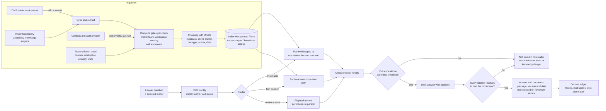

# Design: Matter-Aware Legal AI for a Law Firm

> **Status: design, not implemented.** This document describes how the
> capability modules in this repo compose into a legal research, drafting and
> knowledge system for a law firm. Pieces move from design to built as their
> modules land, and each one ships with the number that proves it. Nothing
> here has been run against a live document management system, conflicts
> system or real client data.

---

## The Problem

A law firm's knowledge lives in two very different places.

**Matter files** hold client work: agreements, correspondence, drafts,
diligence. They sit in matter workspaces in a document management system
(DMS), and they belong to the client, not the firm.

**Firm know-how** holds what the firm has learned: precedents, standard
positions, practice notes, clause banks. Knowledge lawyers curate it, and it is
meant to be reused across clients.

Lawyers ask three kinds of question:

- "What does the Acme supply agreement say about termination for convenience?"
  is a **matter question**. It must be answered from that matter only.
- "What is our standard position on caps on liability in SaaS deals?" is a
  **know-how question**. It is answered from firm knowledge, never from another
  client's file.
- "Mark up this draft against our playbook" is a **review task**. It combines
  both: the client's document and the firm's positions.

Three constraints decide most of the design:

1. **Confidentiality is the whole game.** Lawyers owe each client a duty of
   confidentiality, and firms run **ethical walls**: when a conflict exists,
   named people are barred from a matter even though their role would normally
   grant access. An assistant that ignores a wall is a professional
   responsibility breach, not a bug.
2. **Matters never mix.** Client A's documents must never shape an answer for
   client B, whether through retrieval, a shared cache, conversation memory or
   an example in a prompt.
3. **Every claim must be checkable.** A lawyer signs the work. An answer that
   cannot be traced to a specific document and passage is worse than no answer,
   because it costs review time and invites error.

---

## Architecture

---

## Decisions

### 1. The matter is the unit of retrieval

Every matter question runs against exactly one matter, selected by the user and
checked against their access. There is no firm-wide search over client files.
This is the same scoping rule [07_rag](../../07_rag) already applies to one
contract under review, raised from contract to matter.

Cross-matter search is the feature lawyers ask for and the one most likely to
breach confidentiality. It stays out until the firm's risk function defines
which matters, if any, can be pooled, and on what terms.

### 2. Two corpora, never blended

Matter documents and know-how sit in separate collections with separate access
rules. Know-how is firm-wide by design; matter content is not. The router
decides which collection a question touches, and a single retrieval call never
spans both. In the review task, the playbook position and the client clause
are retrieved separately and only meet in the prompt for that one matter.

Know-how earns its firm-wide status through curation: knowledge lawyers remove
client identifiers before a document enters the library. The system does not
attempt that anonymisation itself.

### 3. Walls are deny rules, and deny wins

The access model in 07_rag is built from **allow gates**: a user sees a chunk
only if they hold a principal in every gate. Workspace security and matter
teams fit that model directly.

Ethical walls do not. An exclusionary wall names people who must not see a
matter, even if they are on the practice group that normally would. That needs
an **exclusion gate**: a chunk is hidden from any user named in it, regardless
of every allow gate. The rule is evaluated last and cannot be overridden by
any other grant.

| Rule | Type | Source |
| --- | --- | --- |
| Workspace security (open or restricted) | Allow | DMS |
| Matter team membership | Allow | DMS or practice management system |
| Inclusionary wall (only these people) | Allow, replaces the default | Conflicts and walls system |
| Exclusionary wall (never these people) | **Deny, always wins** | Conflicts and walls system |

### 4. Delegate when possible, replicate only where forced

Where the DMS search API can run as the user, the system calls it with the
user's own identity and lets the DMS apply its own security. Nothing is
replicated, so nothing can drift. This is the same reasoning as the bounded,
read only tool in [08_tools](../../08_tools).

The semantic index cannot ask the DMS per chunk, so there the gates travel with
the content and the leakage test proves they hold.

### 5. A stale wall is a breach, so walls are pushed and the system fails closed

Walls change at the worst moment: a new conflict appears at matter intake or
when a lateral lawyer joins. Wall changes are pushed as events and applied
before the next query, not picked up by a nightly crawl. Reconciliation still
runs to catch missed events.

If the wall feed is late beyond a set tolerance, matter retrieval is switched
off and only know-how stays available. A slower answer is acceptable. A leak
across a wall is not.

### 6. A router and fixed workflows, not an open agent

The three question shapes are distinct, and a classifier plus the user's
selected matter can tell them apart. Playbook review is a fixed workflow: fan
out one check per clause type in parallel, then an evaluator pass compares
each clause with the firm position and flags deviations. Those are the
parallelization and evaluator-optimizer patterns from Phase 1. An open agent
choosing its own tools across client files is not justified until evaluation
shows the fixed paths failing on real questions.

### 7. Lexical first, reranking always

On CUAD, BM25 plus a cross encoder reranker matched hybrid retrieval, and dense
retrieval on its own trailed BM25 by about 5.5 points. Legal drafting repeats
exact terms of art, which lexical retrieval matches directly. BM25 plus rerank
is the default for matter documents. Know-how is a different corpus: lawyers
phrase questions in their own words against practice notes written in others,
so dense retrieval may earn its place there. The same ablation runner decides.

### 8. Two abstention gates, and the lawyer signs

- **Before generation:** if the top reranked score is below a threshold
  calibrated on the evaluation set, the answer is "not found in this matter,"
  and the system names the matter team or knowledge lawyer to ask.
- **After generation:** every citation must resolve to text the model was
  shown, or the answer is withheld. On CUAD this rule stopped every fabricated
  or paraphrased quote, about a third of the model's quotes, from shipping as
  a supported answer.

Every output is marked as a draft for lawyer review, with the document,
passage, version and date it relied on. Responsibility for advice stays with
the lawyer.

### 9. Data handling is a requirement, not a setting

Client data is not used to train models, model providers keep no prompts or
outputs beyond what the contract allows, and processing stays in the regions
the client engagement requires. These are settled with the firm's risk,
information security and client teams before build, and the architecture
records which model endpoints satisfy them. Matter context is never cached or
remembered across sessions or users.

---

## What Gets Measured

Every row becomes a number the repo produces once its module is built.

| Measure | How | Gate |
| --- | --- | --- |
| Wall leakage | Walled personas query for content in matters they are excluded from; count chunks returned | **Zero. Hard gate.** |
| Cross-matter contamination | Users on matter A ask questions whose answers exist only in matter B; count matter B chunks returned | **Zero. Hard gate.** |
| Wall freshness | Time from wall event to enforced in retrieval; share of queries served while the feed was late | Within tolerance, fail closed beyond it |
| Retrieval quality | Hit@k and MRR on lawyer-labelled questions per practice area | Beat the BM25 baseline |
| Citation resolution | Share of shipped answers where every citation resolves | 100% of shipped answers |
| Citation on the right passage | Share of valid citations on the lawyer-marked passage | Tracked per practice area |
| Abstention quality | Correct "not found" on questions with no answer in the matter | Calibrated on the eval set |
| Playbook review accuracy | Deviations flagged against a lawyer's markup of the same draft | Set with the practice group |
| Adoption and time saved | Weekly active lawyers per practice group, turnaround versus baseline | Set per use case |
| Cost | Cost per answer and per matter | Tracked in 11 AI FinOps |

Both leakage tests run at the retrieval layer, not through the model. They are
deterministic and cheap, so they run on every change, each with a positive
control (filter off) so a zero means the filter held rather than the test went
blind.

---

## Where Each Piece Lives

| Piece | Module | Status |
| --- | --- | --- |
| Lexical retrieval, rerank, cited answers, abstention | [07_rag](../../07_rag) | Built on CUAD |
| Allow-gate filtering and leakage test | [07_rag](../../07_rag) | Built on a synthetic wiki |
| Exclusion gates for ethical walls, wall leakage test | 07_rag extension | Planned |
| Cross-matter contamination test | 07_rag extension | Planned |
| Bounded, read only tool running as the user | [08_tools](../../08_tools) | Built against a mock Jira; DMS version planned |
| Router and playbook review workflow | Phase 1 patterns | Patterns built; not yet on legal data |
| Traces and policy checks | 10 Guardrails and observability | Planned |
| Cost per answer and per matter | 11 AI FinOps | Planned |

---

## Build Versus Buy

Legal AI platforms and DMS vendors now offer assistants for research, drafting
and review. Building is justified only when at least one of these is true:

- The firm's know-how and playbooks are the differentiator, and a vendor tool
  cannot be grounded in them under the firm's own controls.
- Walls and matter security must be enforced the same way across several
  sources, not separately inside each vendor tool.
- Model choice, data residency or client-specific terms rule out the vendor's
  hosting.
- The goal is a reusable firm pattern that many practice groups build on, not
  one assistant.

If none apply, buy, and spend the effort on evaluation, walls integration and
adoption instead.

---

## Open Questions

- How to encode exclusion lists for large walls in a vector store payload
  without bloating every chunk, and whether walled matters should get their own
  index instead.
- How to handle a document filed to more than one matter with different teams
  or walls.
- Whether the semantic index should hold matter documents at all, or only
  know-how, with matter questions answered through the DMS's own search running
  as the user.
- How knowledge lawyers verify that a know-how document is free of client
  identifiers before it becomes firm-wide.
- What a lawyer-labelled golden set looks like per practice area, and who owns
  keeping it current.
